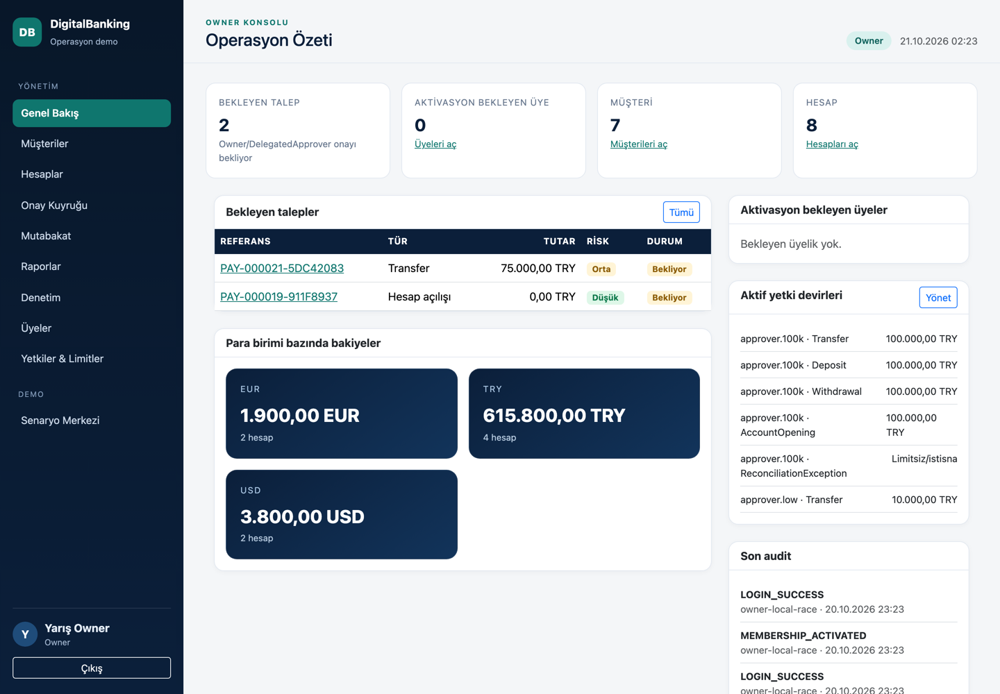
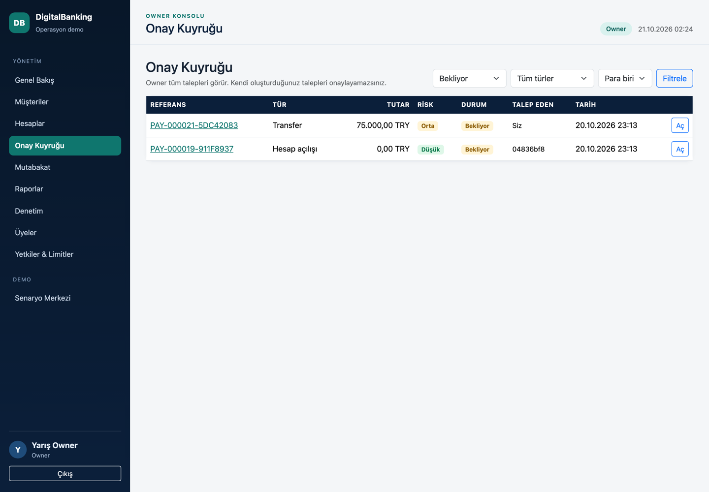
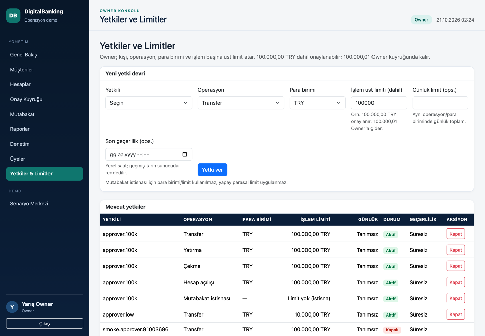
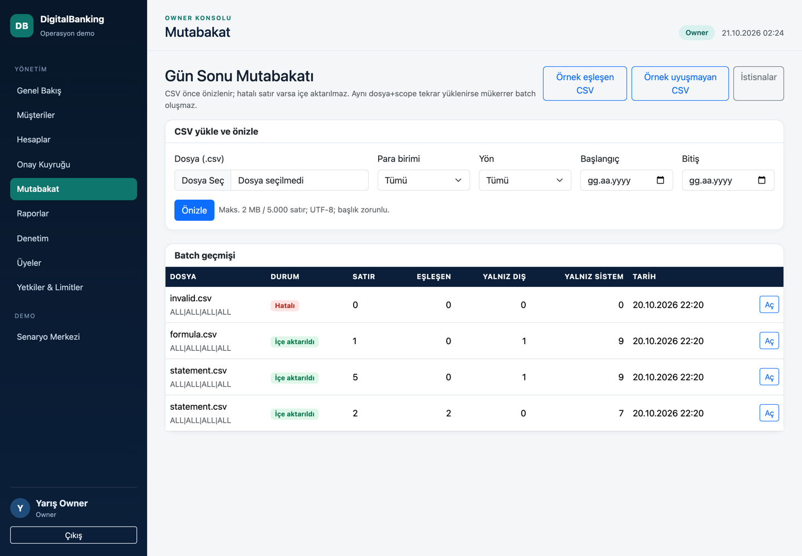
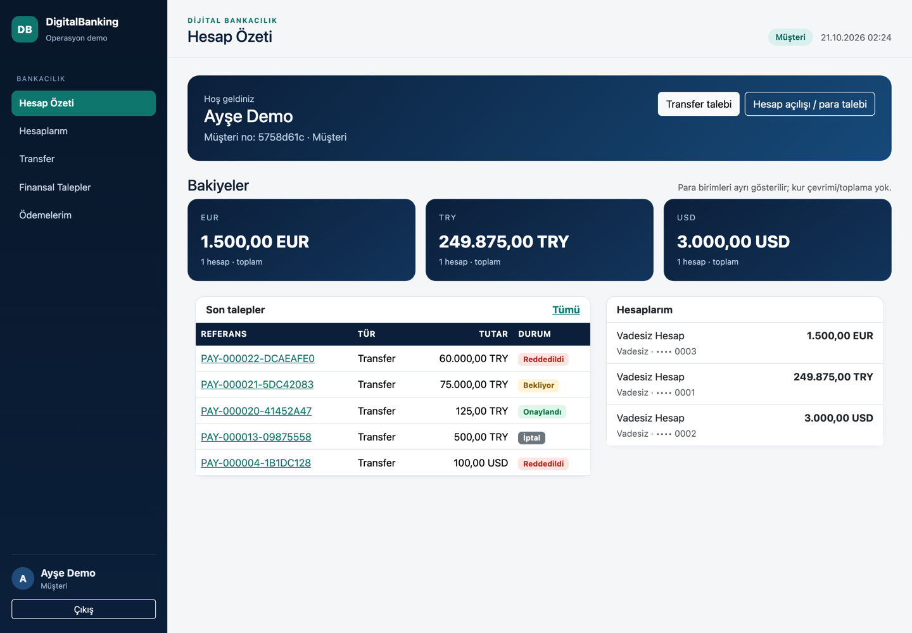
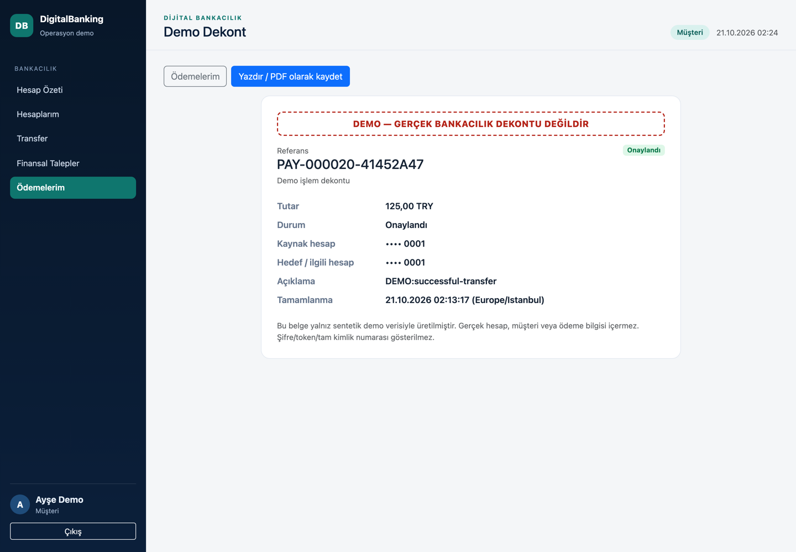
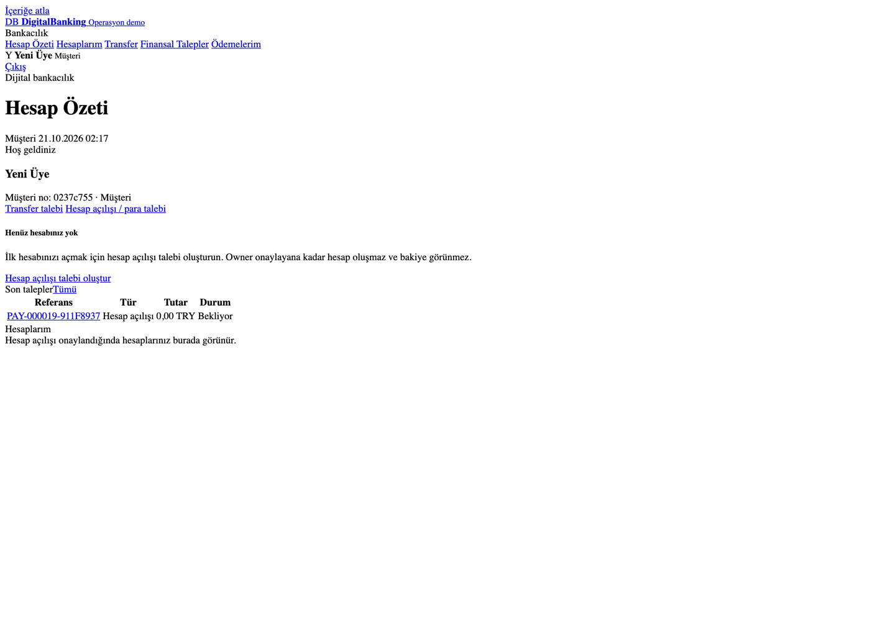
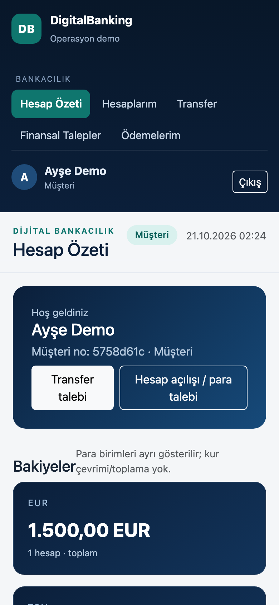
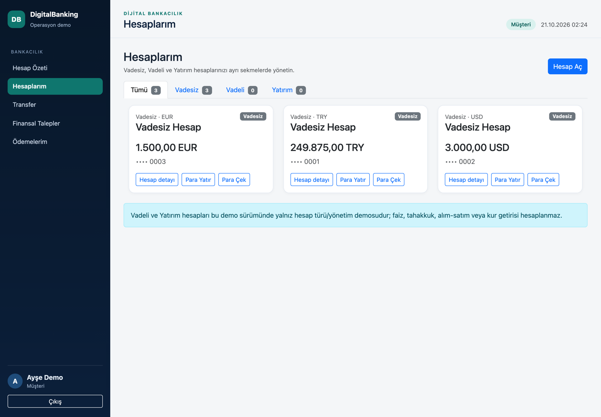
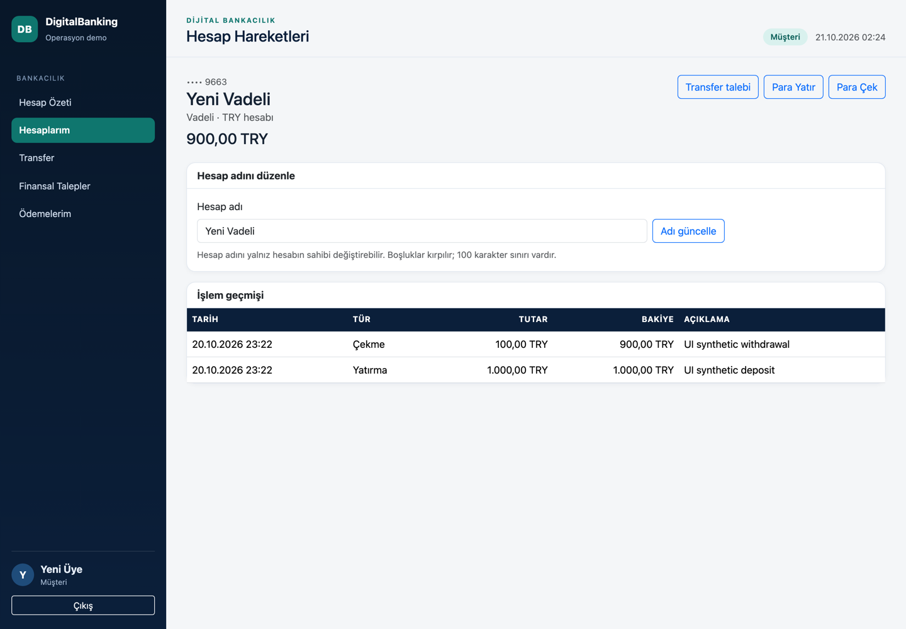

# DigitalBanking — banking controls portfolio demo

> **Status (2026-10-20):** working .NET 10 API + Razor dashboard, **150 xUnit tests** and **280 end-to-end smoke checks** passing locally. SQL Server migrations are generated but **not applied or verified**. This is an educational, synthetic demo — not production banking software.

DigitalBanking is a small retail-banking back office that makes the controls behind money movement visible: a **one-time Owner**, **delegated approval authority**, **maker-checker for every financial request**, **inclusive per-operation limits**, **live revocation**, **idempotent posting**, **customer ownership**, **timeline/receipt**, and **day-end reconciliation with an exception workflow**.

## The 30-second version

Most banking demos stop at CRUD. This one starts where operations actually get hard: who may approve what, for how much, in which currency, and what happens when authority is revoked, two requests overcommit one balance, or an external statement does not match the ledger.

Every customer financial request — transfer, deposit, withdrawal, account opening — is created as **Pending** and moves no money. The Owner or an explicitly delegated approver must approve it. The delegated limit is **inclusive**: a **100,000.00 TRY** request is allowed; **100,000.01 TRY** requires the Owner. The Owner's own request also cannot be self-approved. All authority is re-read from the database on every approval, so a revoked delegation or stale JWT stops working immediately.

- **Stack:** C# / .NET 10, ASP.NET Core Web API + Razor Pages, EF Core 10, SQL Server (default) / SQLite (Development only), xUnit.
- **Verified locally:** build 0 warnings / 0 errors, **150 xUnit tests**, **280 smoke checks**, NuGet vulnerable-package audit clean.
- **Try it:** `bash scripts/dotnet.sh build DigitalBanking.slnx`, then `python3 scripts/run_local.py --api-port 5180 --dashboard-port 5181`, open <http://127.0.0.1:5181>.
- **API/Swagger:** <http://127.0.0.1:5180/swagger> · **Health:** <http://127.0.0.1:5180/health>

## Roles and authority

| Role | Who | Can do | Cannot do |
|---|---|---|---|
| **Owner / SuperAdmin** | First local setup only; never seeded or self-registered | Activate/disable members; change Customer/DelegatedApprover roles; assign per-user, per-operation, per-currency limits; see all requests, audit, customers, accounts, reconciliation, demo center; approve any request | Approve/reject **own** request; disable/demote the last Owner; create a second Owner through public registration |
| **DelegatedApprover** | Active member promoted by Owner | Approve/reject requests matching an active delegation (operation + currency + `amount <= max` and optional daily total/expiry) | Self-approve; approve another currency/operation/limit; manage users, roles or delegations; escalate self/others to Owner |
| **Customer** | Public registration, then Owner activation | See only own profile/accounts/transactions; request transfers, deposits, withdrawals, account opening; track own timeline; download a completed demo receipt | Move money directly, approve anything, see another customer's data |
| **PendingActivation** | Public registration default | Sign in is blocked | Any business action until Owner activates |

Public registration accepts only **username, email, first/last name, password + confirmation**. Role, limits, ownership and balance are never accepted from the client. There is no email-verification claim.

### Approval and limit rules

- **No auto-approval.** A low-risk request is still `Pending`; risk is shown, not used to bypass approval.
- **Account products:** Vadesiz, Vadeli and Yatırım accounts are separated by tabs; every account has a customer-editable name, type, currency and masked number. Vadeli/Yatırım are management-only demo products (no interest, accrual, trading or FX return).
- **First account:** a newly activated customer with no account can request an opening without selecting an existing account. The request carries type/name/currency through approval; the account appears after Owner/delegated approval.
- **Per-account money requests:** Para Yatır and Para Çek create Pending requests with an amount/description summary; balance changes only on approval. Self-approval, idempotency and rollback rules remain unchanged.
- **No money moves at creation.** Pending outgoing transfers/withdrawals reserve available balance, but the ledger changes only on approval. The request row, timeline and audit entry are created in one transaction.
- **Ownership is rechecked at approval.** If the requester is no longer linked to the customer profile, or the source account has moved to another customer while the request was pending, approval is refused without moving money.
- **Inclusive boundary.** `100,000.00 TRY` is eligible for a delegation with `MaxAmount = 100,000.00`; `100,000.01 TRY` is denied and routed to the Owner.
- **Daily cumulative limit** is optional per delegation and counts approvals by that approver for the same operation/currency/UTC day.
- **Live authority.** Role, status, delegation `IsActive`, `ExpiresAt`, limit and daily usage are checked from the database at approval time — not trusted from the JWT or the screen.
- **Last Owner protection.** The Owner cannot be disabled, demoted, or assigned through the role endpoint; setup closes permanently after the first Owner exists.
- **Owner's own request** is subject to the same maker-checker self-approval block and needs another authorized reviewer.
- **Live demo-center authority.** Demo seed/reset also re-read the caller's current Owner/Active state from the database; a stale Owner JWT is not enough.

## Demo personas (synthetic only)

| Username | Role | Purpose |
|---|---|---|
| *(chosen locally)* | Owner | Created once through `/Setup`; password is chosen by the local user, never seeded or committed |
| `customer.a` | Customer | TRY 250,000 / USD 3,000 / EUR 1,500 synthetic accounts |
| `customer.b` | Customer | TRY 25,000 / USD 800 / EUR 400 synthetic accounts |
| `approver.100k` | DelegatedApprover | Transfer/deposit/withdrawal/account-opening TRY limit 100,000; reconciliation exceptions without a monetary cap |
| `approver.low` | DelegatedApprover | TRY transfer limit 10,000, for the "over my limit" path |
| `applicant.pending` | PendingActivation | Demonstrates blocked login until Owner activation |

Demo passwords are generated locally into `.local/credentials.json` (mode `0600`, git-ignored) and are never committed or shown by the smoke test. The Owner password is chosen during local setup and is not part of the seed.
### Signing in locally

1. Start the app and open the dashboard. With no Owner, `/Setup` is the only way to create the first Owner; choose the local password yourself.
2. Owner signs in and opens **Üyeler** to activate `applicant.pending` or a newly registered member and assign Customer/DelegatedApprover.
3. `customer.a` / `customer.b` use the synthetic demo password stored locally under `password` in `.local/credentials.json`.
4. `approver.100k` / `approver.low` use the same local demo password; their authority comes from the Owner's role + delegation rows, not from the password.
5. `applicant.pending` cannot sign in until activated; the login screen now explains this in Turkish instead of showing a service error.
6. Never copy the UAT `.local` directory or its database into this worktree, and never paste a password/token into screenshots, chat or commits.

## First-run flow

1. Delete/archive `.local/digitalbanking.db*` if you need a clean synthetic database.
2. Start the API and dashboard.
3. Open <http://127.0.0.1:5181>. The dashboard redirects to **`/Setup`** while no Owner exists.
4. Create the first Owner (loopback + Development only). The endpoint then closes and returns `409` on any repeat. A filtered unique DB index guarantees that two simultaneous setup requests cannot create two Owners; the loser receives `409`.
5. Sign in as Owner. Activate `applicant.pending` or a newly registered member, assign **Customer** or **DelegatedApprover**, then use **Yetkiler & Limitler** to grant operation/currency limits.
6. Demo data is seeded deterministically; the Owner-only **Demo Merkezi** can seed the scenario set and reset only `IsDemo` rows.

Rate limits are deliberately separated: login 20/min per IP, registration 5/10 min, Owner setup 5/10 min. A `429` returns a Turkish JSON message and `Retry-After` (60 s login, 600 s registration/setup).

Public registration at `/Register` can never create an Owner. There is no client-supplied role, limit, ownership or balance.

## End-to-end scenarios to try

| Scenario | What to observe |
|---|---|
| Customer transfer below/at/above limit | `99,999.99` and `100,000.00` TRY can be approved by `approver.100k`; `100,000.01` is absent from the delegated queue and returns a safe denial; Owner can reject it |
| Owner self-approval | Owner-created request stays `Pending`; Owner approve/reject returns `400`; another reviewer or cancellation is required |
| Revocation / old JWT | Deactivate a delegation or change the approver's role; the already-issued token immediately loses authority from the DB check |
| Pending overcommit | Two outgoing requests cannot reserve more than the available balance; cancelling frees the reservation |
| Timeline / receipt | Pending request shows status but no completed receipt; approved request shows Created → Pending → Approved → Completed and a masked, DEMO-marked printable receipt |
| Reconciliation | Upload matched CSV → preview → import; duplicate file is detected by SHA-256; mismatches become only-external/only-system/amount/currency/duplicate rows |
| Exception workflow | Open → InReview → ResolutionProposed → Closed/Rejected; proposer cannot approve own resolution; no balance adjustment is ever made |
| Demo center | Seed is idempotent; reset removes only demo-marked payments/transactions/timeline; Owner-only and Development-only, endpoints return 404 outside Development |

## Architecture

```text
Browser (Razor Pages, Turkish UI)
   │  server-side session cookie (JWT never rendered)
   ▼
Dashboard ── HTTP + Bearer JWT ──► ASP.NET Core API
                                     ├─ JWT auth: Guid nameidentifier, role claim
                                     ├─ Exception middleware → ApiResponse
                                     ├─ Rate limiter + per-user login throttle
                                     ├─ Idempotency-Key filter (money/approval endpoints)
                                     ├─ Controllers (coarse role policy)
                                     └─ Services (authoritative checks from DB)
                                          ├─ PaymentApprovalService (all-request maker-checker)
                                          ├─ ApprovalAuthorizationService (delegation/limit)
                                          ├─ UserIdentityService / DelegationService
                                          ├─ CustomerPortalService / PaymentTimelineService
                                          ├─ ReconciliationService (preview/import/exceptions)
                                          ├─ DemoScenarioService (Development-only)
                                          └─ EF Core → SQL Server (default) / SQLite (local)
```

Key payment path:

1. Controller builds `ActorContext` only from validated JWT claims.
2. Service re-reads the **current** user role/status and delegation rows.
3. It revalidates account ownership, currency, available balance, amount scale and request status.
4. Approval writes balance + debit/credit ledger + status + timeline + audit in one transaction; `RowVersion` blocks a concurrent double approval.
5. A replay with the same `Idempotency-Key` returns the stored response; a different payload returns `409`.

## Money, security and data rules

- **Decimal only**, two decimal places; extra scale is rejected, never rounded. TRY/USD/EUR/GBP; **no FX** and no cross-currency totals.
- **Ownership from the database:** `Customer.UserId` joins accounts and payments to the JWT user. IDOR attempts return `404`, not another customer's data.
- **JWT identity:** Guid `NameIdentifier` + role claim; passwords PBKDF2-SHA256 600k with rehash; login throttle and rate limiting.
- **Direct movement endpoints are disabled** (`POST /api/accounts/transfer`, `/open`, `/api/transactions/deposit|withdraw` return `400` with the approval-request route). All financial movement must use the request workflow.
- **Reconciliation is operational only.** Closing/rejecting an exception records a decision; it never changes a customer balance. Imported batch results are immutable; pending approvals are excluded from "only in system" and counted separately.
- **CSV export is formula-safe:** cells beginning `= + - @` are prefixed with `'` before export.
- **Timeline/receipt** is built from persisted events, enforces payment ownership, shows completed receipt data only after completion, masks account numbers, uses `Europe/Istanbul` for display and carries an explicit **DEMO** disclaimer.
- **UTC storage**; report date ranges are UTC with an inclusive whole-day `to`. Receipt display converts to Europe/Istanbul.

## Verified results

Environment: macOS ARM64, .NET SDK **10.0.402**, EF Core **10.0.3**, SQLite Development database, 2026-10-20.

| Check | Result |
|---|---|
| `bash scripts/dotnet.sh build DigitalBanking.slnx` | **0 warnings, 0 errors** |
| `bash scripts/dotnet.sh test DigitalBanking.slnx` | **150 passed, 0 failed, 0 skipped** |
| `python3 scripts/smoke_test.py --api-port 5180 --dashboard-port 5181` | **280 checks passed** |
| NuGet vulnerable-package audit | no vulnerable packages reported by current sources |
| `git diff --check` | clean |

The smoke run covers setup closure, membership activation, role/limit boundaries (`99,999.99 / 100,000.00 / 100,000.01` TRY), other currency, daily limit, reserve-aware overcommit, live revocation and stale JWT, Owner self-approval block, IDOR, timeline/receipt/masking, reconciliation replay/match/mismatch/exception flow, formula-safe export, demo seed/reset, audit and dashboard session/role guards. Evidence: [`docs/evidence/`](docs/evidence/); details: [`docs/TEST_REPORT.md`](docs/TEST_REPORT.md).

**Not verified:** SQL Server connection/apply, real SQL Server decimal/concurrency behaviour, production hardening, load/penetration/accessibility audits, and manual browser UAT. SQLite is not SQL Server proof.

## Quick start

Prerequisites: macOS/Linux with the bundled .NET 10 SDK at `~/Documents/Codex/toolchains/dotnet` (or `DOTNET_ROOT`), Python 3.

```sh
bash scripts/dotnet.sh build DigitalBanking.slnx
python3 scripts/run_local.py --api-port 5180 --dashboard-port 5181

# another terminal, disposable synthetic DB:
python3 scripts/smoke_test.py --api-port 5180 --dashboard-port 5181
```

- Dashboard: <http://127.0.0.1:5181>
- Swagger: <http://127.0.0.1:5180/swagger>
- Health: <http://127.0.0.1:5180/health>

The first run writes `.local/credentials.json` (mode `0600`) with a random demo password and JWT secret. **Never commit, share, screenshot or paste this file.** `.local/` is git-ignored.

### Database reset / existing SQLite upgrade

SQLite uses `EnsureCreated`, not migrations. A fresh start creates the current schema and reseeds synthetic personas; a fresh DB has **no Owner**, so use `/Setup` once. For an existing synthetic database, stop the app and run the additive, backup-producing upgrade (dry-run first):

```sh
python3 scripts/upgrade_sqlite_account_metadata.py .local/digitalbanking.db
python3 scripts/upgrade_sqlite_account_metadata.py .local/digitalbanking.db --apply
```

The script refuses UAT-looking paths and never drops data. Existing accounts become **Vadesiz**. Do not run it against `outputs/DigitalBanking-UAT` or its `.local`.


### Tests

```sh
bash scripts/dotnet.sh test DigitalBanking.slnx
```

This harness required single-node/no-shared-compilation flags (`-p:UseSharedCompilation=false -m:1 -nr:false`) because the sandbox blocked the shared Roslyn compiler. The plain command is the normal developer path.

The smoke test needs the local Owner login. It reads `owner_username`/`owner_password` from `.local/credentials.json` or `SMOKE_OWNER_USERNAME`/`SMOKE_OWNER_PASSWORD`. On a clean DB it can create the one-time Owner itself; never commit those values. Demo persona passwords remain `password` in the same local file.

## Dashboard scope

Implemented Razor Pages (Turkish, navy/neutral palette, local Bootstrap, session guards):

- **Setup / Login / Register / Logout**, role-based landing.
- **Owner:** overview, approval queue + details + receipt, membership activation/roles, **Delegations (Yetkiler & Limitler)**, customers/accounts, operational request form, audit, reconciliation (list/details/exceptions/sample/export), demo center, top-account report.
- **DelegatedApprover:** eligible approval queue, own reviewed history; user/role/delegation pages are denied.
- **Customer:** home balance cards per currency, own accounts/details, transfer wizard with pre-confirmation, requests, payments/timeline and printable demo receipt.
- Every screen has empty/error/success states; money is formatted per culture; account numbers are masked in customer/receipt views; no fake logos and no fabricated screenshots.
- Newly activated customers with no accounts see a first-account CTA; the request form defaults to **Hesap açılışı** and transfer explains that an approved account is required first.
- `Hesaplarım` has **Tümü / Vadesiz / Vadeli / Yatırım** tabs, per-tab empty states and a visible **Hesap Aç** button, plus Para Yatır/Para Çek shortcuts and an owner-only account-name edit form.
- Delegated limits show the inclusive boundary, currency, operation and expiry in Turkish; expiry input is local time and is stored/compared in UTC. Tables scroll inside their cards on narrow screens instead of expanding the page.
- Service/business messages that can reach the UI are mapped to Turkish; a pending-activation login explains Owner activation instead of a generic service error.

### Screenshots

Captured from the running local demo on **2026-10-20** with headless Chrome, synthetic data and no credentials/tokens visible. These are real screenshots, not mockups.

| Owner overview | Owner approval queue |
|---|---|
|  |  |

| Delegated authority and limits | Reconciliation |
|---|---|
|  |  |

| Customer home (separate currencies) | Completed demo receipt |
|---|---|
|  |  |

| First account request | Narrow viewport |
|---|---|
|  |  |

| Account tabs and cards | Account detail |
|---|---|
|  |  |

More real captures (desktop/narrow delegation and transfer screens) are in [`docs/screenshots/`](docs/screenshots/). Capture was done against a disposable SQLite Development database; the Owner password and `.local` files are not shown. No screenshot was fabricated or edited to add data.

## Project structure

```text
DigitalBanking.API            HTTP API, JWT, idempotency filter, middleware, Swagger
DigitalBanking.Application    contracts, DTOs, validators, CSV parser, policy
DigitalBanking.Domain         entities and enums
DigitalBanking.Infrastructure EF Core, migrations, security, services, seed
DigitalBanking.Dashboard      Razor Pages (Owner / DelegatedApprover / Customer)
DigitalBanking.Tests          xUnit rule, ownership, reconciliation and identity tests
docs/                         reports, ADR, UAT, migration/reconciliation docs, evidence
scripts/                      dotnet wrapper, local runner, smoke test, VS Code SDK checks
```

## Selected API surface

| Endpoint | Access | Notes |
|---|---|---|
| `GET /api/setup/status`, `POST /api/setup/owner` | anonymous, loopback + Development only | one-time Owner setup; closes with `409` |
| `POST /api/auth/register`, `/login` | anonymous | registration → `PendingActivation`; no role input |
| `GET /api/auth/me` | authenticated | identity from validated claims |
| `GET /api/me/*`, `POST /api/me/transfers`, `/requests` | Customer | own data only; all financial requests `Pending` |
| `GET /api/me/payments/{id}/timeline`, `/receipt` | Customer (owner) | persisted events; completed-only receipt data |
| `GET /api/paymentapprovals/queue`, `/{id}` | Owner / eligible delegated | DB-checked eligibility |
| `POST /api/paymentapprovals/{id}/approve`, `/reject`, `/cancel` | Owner / delegated / requester rules | self-approval and self-reject blocked |
| `POST /api/paymentapprovals/requests` | Owner | operational transfer/deposit/withdrawal/account opening |
| `GET/POST /api/users`, `/activate`, `/disable`, `/role` | Owner | last-Owner and role-escalation protections |
| `GET/POST /api/delegations`, `PUT`, `/deactivate` | Owner | per operation/currency limit; live revocation |
| `POST /api/reconciliation/preview`, `/{id}/import`, `batches`, `export` | Owner | `.csv`, SHA-256 duplicate detection |
| `GET/POST /api/reconciliation/exceptions/*` | Owner / DelegatedApprover | Open → InReview → Proposed → Closed/Rejected; reopen |
| `GET/POST /api/demo/*` | Owner, Development only | seed/reset/sample; 404 elsewhere |

Direct `POST /api/accounts/transfer`, `/open`, `/api/transactions/deposit|withdraw` intentionally return `400` and point to the approval workflow.

## Known limitations

- **SQL Server is unverified.** The two recent SQL Server migrations are generated and documented, not applied. SQLite tests are not SQL Server evidence. Operators must map legacy `Admin=1` / `User=2` roles explicitly; they are intentionally invalid and never converted to Owner/Customer.
- **No FX conversion.** Limits and risk are nominal in the account currency.
- **Login throttle is in-memory.** A multi-instance deployment needs a shared store.
- **UTC report dates.** Receipt display uses Europe/Istanbul, but report ranges are UTC; no banking cut-off calendar.
- **No production hardening.** No secret manager, WAF, distributed observability/retention/immutability, compliance certification or penetration test is claimed.
- **VS Code GUI SDK discovery** needs the user-run launchd step and a VS Code restart; the GUI was not verified by the agent.
- **Manual UAT** is documented in [`docs/UAT_CHECKLIST.md`](docs/UAT_CHECKLIST.md) but has not been executed/filled by the user.
- **AI contribution** is real; see [`docs/PORTFOLIO_NOTES.md`](docs/PORTFOLIO_NOTES.md).

## Documentation

- [Development completion report](docs/DEVELOPMENT_COMPLETION_REPORT.md)
- [Test report](docs/TEST_REPORT.md)
- [Verification record](docs/VERIFICATION.md)
- [Progress / continuation notes](docs/PROGRESS.md)
- [Findings and limits](docs/DEEPSEEK_FINDINGS.md)
- [Payment/role/delegation ADR](docs/adr/0001-payment-and-role-policy.md)
- [Migration operator notes](docs/migrations/README.md)
- [Reconciliation CSV format](docs/RECONCILIATION_FORMAT.md)
- [Dashboard scope](docs/DASHBOARD_PRODUCT_BRIEF.md)
- [Manual UAT checklist](docs/UAT_CHECKLIST.md)
- [Portfolio/CV notes](docs/PORTFOLIO_NOTES.md)
- [Local development](docs/LOCAL_DEVELOPMENT.md)
- [Integration handoff / manifest](docs/INTEGRATION_HANDOFF.md)

## Türkçe özet

DigitalBanking, .NET 10 ile geliştirilmiş sentetik bir bankacılık operasyon demosudur. Müşteri transferi, para yatırma/çekme ve hesap açılışı dahil **her finansal talep** oluşturulduğunda `Pending` kalır; para hareket etmez. **Owner** tüm talepleri görür ve onaylayabilir; **DelegatedApprover** yalnız kendisine verilen operasyon/para birimi/limit kapsamında onaylayabilir. Limit **dahildir**: 100.000,00 TRY onaylanabilir, 100.000,01 TRY Owner'a gider. Owner kendi talebini onaylayamaz. Rol, limit, günlük kullanım ve yetki iptali her onayda veritabanından okunur; eski JWT veya açık ekran yetki vermez.

Üyelik kaydı yalnız kullanıcı adı, e-posta, ad-soyad ve şifre alır; hesap **Owner aktivasyonuna kadar** `PendingActivation` durumundadır. Owner ilk kez yalnız localhost `/Setup` üzerinden oluşturulur, sonrasında bu uç kapanır; public kayıt asla Owner yaratamaz. Demo müşterileri `customer.a`, `customer.b`, yetkililer `approver.100k`, `approver.low`, bekleyen üye `applicant.pending` sentetiktir. Şifreler `.local/credentials.json` içinde yerel ve gizlidir; commit edilmez.

Ekranlar Türkçe, lacivert/nötr tasarımlı; müşteri yalnız kendi hesap ve hareketlerini görür, tamamlanmış işlem için maskeli ve **DEMO** uyarılı yazdırılabilir dekont alır. Gün sonu mutabakatta CSV önizleme/içe aktarma, SHA-256 mükerrer kontrolü, eşleşme/eşleşmeme sınıfları ve istisna iş akışı vardır; istisna kapatmak **bakiye düzeltmez**.

Doğrulama: **0 uyarı/0 hata build**, **150 xUnit testi**, **280 smoke kontrolü**. SQL Server migration'ları üretildi ancak **uygulanmadı/doğrulanmadı**; SQLite sonucu SQL Server kanıtı değildir. Üretim güvenliği, gerçek banka entegrasyonu veya kur çevrimi iddiası yoktur. AI katkısı ve insan yönlendirmesi [`docs/PORTFOLIO_NOTES.md`](docs/PORTFOLIO_NOTES.md) içinde açıklanmıştır.
