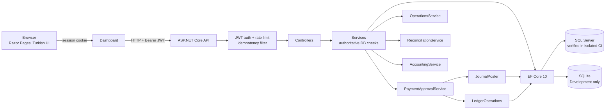
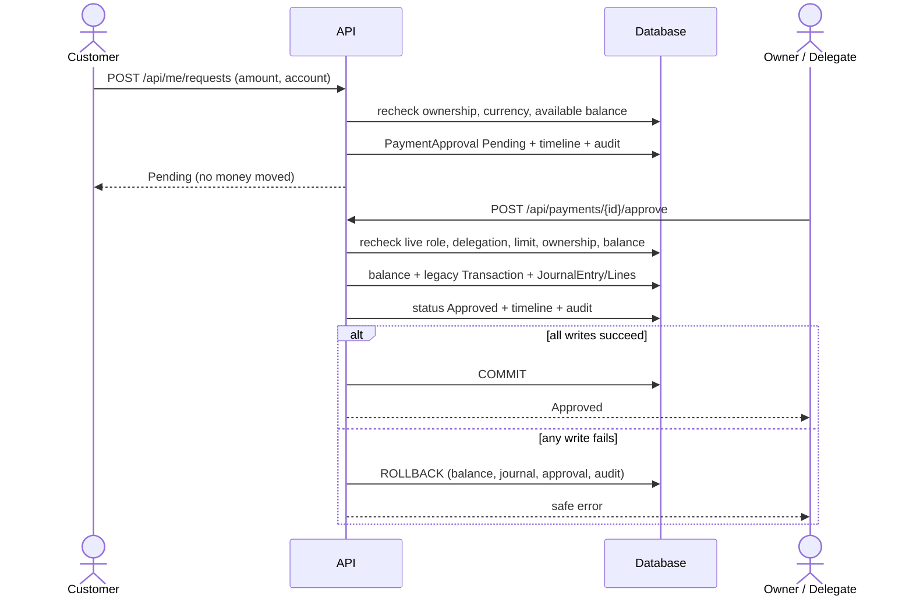
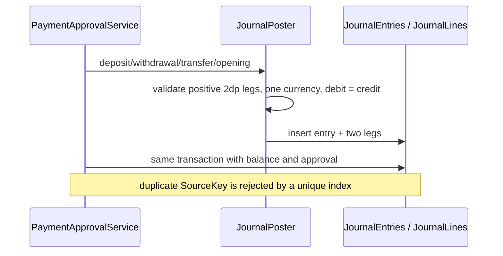

# DigitalBanking — banking controls portfolio demo

> **Status (2026-10-23):** 178 unit tests, 280 general smoke checks and 104 reproducible accounting/operations checks passed locally. Hosted [CI](https://github.com/tamerkargin8/DigitalBanking/actions/runs/39990773127) passed; real SQL Server [integration tests](https://github.com/tamerkargin8/DigitalBanking/actions/runs/39990772442) passed **8/8, 0 failed, 0 skipped**, including migrations. Manual user acceptance remains pending. Educational synthetic demo; not production banking software.

DigitalBanking is a small retail-banking back office that makes the controls behind money movement visible: a **one-time Owner**, **delegated approval authority**, **maker-checker for every financial request**, **inclusive per-operation limits**, **live revocation**, **idempotent posting**, **customer ownership**, **double-entry accounting**, **pending-age/SLA operations**, **day-end reconciliation with exceptions**, and an **append-only audit trail**.

## 30-second version

Most banking demos stop at CRUD. This one starts where operations get hard: who may approve what, for how much, in which currency; what happens when authority is revoked, two requests overcommit one balance, a journal fails mid-approval, or an external statement does not match.

Every customer financial request — transfer, deposit, withdrawal, account opening — is created as **Pending** and moves no money. The Owner or an explicitly delegated approver must approve it. The delegated limit is **inclusive**: **100,000.00 TRY** is allowed; **100,000.01 TRY** requires the Owner. The Owner cannot approve their own request. Authority is re-read from the database on every approval, so a revoked delegation or stale JWT stops working immediately.

## Türkçe özet

- **Ne:** .NET 10 API + Razor dashboard ile sentetik bir bankacılık arka ofisi; gerçek banka/ödeme sistemine bağlanmaz.
- **Onay:** Transfer, yatırma, çekme ve hesap açılışı istisnasız `Pending` başlar; onay olmadan para hareket etmez. Owner kendi talebini onaylayamaz.
- **Yetki:** Delegasyon operasyon + para birimi + limit + opsiyonel günlük limit/süre ile sınırlıdır. `100.000,00 TRY` dahil, `100.000,01 TRY` Owner'a gider. İptal/rol değişikliği eski JWT'de bile anında etkilidir.
- **Muhasebe:** Onaylanan her hareket tek para birimli, borç=alacak journal üretir. Eski hesaplar sessizce doldurulmaz; Owner açık baseline preview/post yapar.
- **Operasyon:** Bekleyen yaş/SLA, geciken talepler, atama, çözülmemiş mutabakat farkları; Delegated yalnız canlı yetkisinin kapsadığını görür.
- **Kanıt:** 178 xUnit, 280 smoke, 25/25 muhasebe E2E, 24/24 operasyon E2E; ekran görüntüleri sentetik masked veridir.
- **Kanıt:** GitHub CI başarılı; gerçek SQL Server 8/8 test geçti. **Kalan:** Kullanıcının manuel kabul testi ve demo video kaydı. Üretim veya sertifikasyon iddiası yok.

## Problem → workflow

A demo that only stores balances does not show the hard parts:

1. **Separation of duties** — requester and approver must differ, even for the Owner.
2. **Scoped authority** — a delegated approver needs operation, currency, amount, optional daily cap and expiry, checked live.
3. **Atomic accounting** — customer balance, legacy statement row, double-entry journal, approval state, timeline and audit must commit or roll back together.
4. **Operational backlog** — pending work needs age/SLA visibility, safe assignment and reconciliation gaps, not a silent list.
5. **Truthful history** — old balances are not backfilled silently; an explicit Owner baseline records the opening position.

## Roles and authority

| Role | Who | Can do | Cannot do |
|---|---|---|---|
| **Owner** | First local setup only; never seeded or self-registered | Activate/disable members; change Customer/DelegatedApprover roles; define per-user/operation/currency limits; see all requests, audit, accounting and reconciliation; approve any request | Approve/reject **own** request; disable/demote the last Owner; create a second Owner through registration |
| **DelegatedApprover** | Active member promoted by Owner | Approve/reject requests matching a live delegation: operation + currency + `amount <= max`, optional daily total/expiry; claim/assign permitted work to self | Self-approve; approve outside currency/operation/limit; manage users, roles or delegations |
| **Customer** | Public registration, then Owner activation | See only own profile/accounts/transactions; request transfers, deposits, withdrawals, account opening; track own timeline; download a completed demo receipt | Move money directly, approve anything, see another customer's data or accounting |
| **PendingActivation** | Public registration default | Sign in is blocked | Any business action until Owner activates |

Public registration accepts only username, email, first/last name and password +
confirmation. Role, ownership, limits and balances are never accepted from the
client. There is no email-verification claim.

### Approval and limit rules

- **No auto-approval.** Low risk is still `Pending`; risk is shown, not used to bypass approval.
- **No money at creation.** Pending outgoing requests reserve available balance; balances change only on approval.
- **Inclusive boundary.** `100,000.00 TRY` matches a `MaxAmount = 100,000.00` delegation; `100,000.01 TRY` is denied and routed to the Owner.
- **Live authority.** Role, status, `IsActive`, expiry, limit and daily usage are re-read from the database at approval time.
- **Self-approval block.** Owner and delegated approvers cannot approve/reject their own request.
- **Account ownership is rechecked** at approval; a moved/removed customer link fails safely.
- **Direct movement endpoints are disabled** (`400`) so all money uses the request workflow.
- **Traceability.** Request creation and decision write timeline + audit records in the same transaction.

## Architecture



Approval and journal commit in one transaction:



Journal shape:



## Double-entry accounting

One currency per entry; every leg positive and 2 decimal places; debit total must
equal credit total. Customer deposits are bank liabilities.

| Operation | Debit | Credit |
|---|---|---|
| Deposit | `CashClearing` | `CustomerLiability` (account) |
| Withdrawal | `CustomerLiability` (account) | `CashClearing` |
| Same-currency transfer | source `CustomerLiability` | target `CustomerLiability` |
| Nonzero account opening | `OpeningBalanceOffset` | `CustomerLiability` (account) |
| Baseline gap > 0 | `OpeningBalanceOffset` | `CustomerLiability` (account) |
| Baseline gap < 0 | `CustomerLiability` (account) | `OpeningBalanceOffset` |

- `SourceKey` is unique (`approval:<id>`, `baseline:<accountId>`, `reversal:<entryId>`), so replay/double approval cannot duplicate a journal.
- Journals are append-only: there is no update/delete endpoint. A future correction must be a new linked reversal.
- Zero opening creates no zero journal. Cross-currency, unbalanced, non-positive or over-precision legs are rejected.
- Old history is **not silently backfilled**. Owner preview/post adjusts only the gap between the current balance and the liability already in journals; fully journaled accounts and existing baselines are skipped, and balances are never changed. Totals are per currency (no FX).
- Trial balance is per currency; no FX aggregation is claimed.

## Operations control centre

- Pending age from UTC; a configurable demo SLA (`Operations:PendingSlaMinutes`, default 30) marks `age >= SLA` as overdue.
- Summary: pending, overdue, oldest age, unassigned, assigned-to-me, unresolved reconciliation batches and open exceptions.
- Filters: status, request type, currency, age/SLA and assignment; page size bounded at 50.
- Owner sees all; a delegated approver sees only rows their live delegation permits and never their own request; Customer gets `403`.
- Assignment is operational only: only pending requests, only active eligible targets, delegated can assign only self, and approval still rechecks limits. Repeating the same assignment is idempotent and audited.
- Reconciliation list shows imported batches with unresolved differences; closed/rejected-only batches are treated as resolved. Drill-down goes to the existing batch/exception screens.
- No auto-delete, auto-close, auto-fix, FX total or balance adjustment.

## Security and data rules

- **Decimal only**, two decimal places; extra scale is rejected, never rounded. TRY/USD/EUR/GBP; **no FX** and no cross-currency totals.
- **Ownership from the database**: `Customer.UserId` joins accounts/payments to the JWT user. IDOR attempts return `404`.
- **JWT identity**: Guid `NameIdentifier` + role claim; PBKDF2-SHA256 600k password hashing; login throttle and endpoint rate limits.
- **Idempotency-Key** on money/approval/assignment actions; replay returns the stored result, a different payload returns `409`.
- **CSV export is formula-safe**: cells beginning `= + - @` are prefixed with `'`.
- **Reconciliation is operational only**; closing an exception never changes a customer balance.
- **Timeline/receipt** masks account numbers, uses `Europe/Istanbul` for display and carries a DEMO disclaimer.
- **UTC storage**, UTC report ranges; operations ages are duration-based.
- No secrets, tokens or `.local` contents are committed, printed or screenshotted.

Selected evidence: [`SECURITY_MATRIX.md`](docs/SECURITY_MATRIX.md). It is an
engineering table, not an OWASP ASVS certification.

## Verified results (real commands)

Environment: macOS ARM64, .NET SDK **10.0.402**, EF Core **10.0.3**, SQLite
Development only.

| Check | Result |
|---|---|
| `bash scripts/dotnet.sh build DigitalBanking.slnx` | **0 warnings, 0 errors** |
| `bash scripts/dotnet.sh test DigitalBanking.slnx` | **178 passed, 0 failed**, 8 SQL Server tests **skipped** |
| Reproducible Stage 3 + 4 E2E (`scripts/stage3_stage4_e2e.py`) | **104/104** (Stage 3 **25/25**, Stage 4 **24/24**) |
| Isolated HTTP smoke (temp DB, 5196/5197) | **280/280 checks, exit 0** |
| Real SQL Server migrations + integration | **8 passed, 0 failed, 0 skipped** |
| GitHub Actions | **PASS** — [build/test/smoke](https://github.com/tamerkargin8/DigitalBanking/actions/runs/39990773127) |
| Manual UAT (5480/5481) | **NOT DONE** |

Reports: [`STAGE_03_REPORT.md`](docs/STAGE_03_REPORT.md),
[`STAGE_04_REPORT.md`](docs/STAGE_04_REPORT.md),
[`STAGE_05_REPORT.md`](docs/STAGE_05_REPORT.md), evidence under
[`docs/evidence/`](docs/evidence/).

## Quick start

Prerequisites: macOS/Linux, .NET 10 SDK (bundled at
`~/Documents/Codex/toolchains/dotnet` or via `DOTNET_ROOT`), Python 3.

```sh
bash scripts/dotnet.sh build DigitalBanking.slnx
python3 scripts/run_local.py --api-port 5180 --dashboard-port 5181
```

- Dashboard: <http://127.0.0.1:5181>
- Swagger: <http://127.0.0.1:5180/swagger>
- Health: <http://127.0.0.1:5180/health>

For a session-independent local demo:

```sh
python3 scripts/start_local_detached.py --api-port 5180 --dashboard-port 5181
```

The first run writes `.local/credentials.json` (mode `0600`) with a random demo
password and JWT secret. **Never commit, share, screenshot or paste this file.**
`.local/` is git-ignored. A fresh DB has **no Owner**: open `/Setup` once and
choose the local password.

### SQL Server vs SQLite

| Provider | Use | Schema path |
|---|---|---|
| **SQL Server** (default) | Intended deployment path | EF Core migrations applied on disposable SQL Server in GitHub CI; 8/8 passed |
| **SQLite** (Development) | Disposable local demo/tests | `EnsureCreated`; never called SQL Server proof |

SQL Server connection is configured through `ConnectionStrings:DefaultConnection`.
The repo does **not** include SQL Server credentials, a persistent server or
a public deployment. See [`SQLSERVER_VERIFICATION.md`](docs/SQLSERVER_VERIFICATION.md).

### Existing SQLite upgrade

SQLite `EnsureCreated` does not alter an existing file. Stop the app and run the
additive, backup-producing upgrade (dry-run first):

```sh
python3 scripts/upgrade_sqlite_account_metadata.py .local/digitalbanking.db
python3 scripts/upgrade_sqlite_account_metadata.py .local/digitalbanking.db --apply
python3 scripts/upgrade_sqlite_journal.py .local/digitalbanking.db
python3 scripts/upgrade_sqlite_journal.py .local/digitalbanking.db --apply
```

The scripts refuse UAT-looking paths and never drop data. Never run them against
`outputs/DigitalBanking-UAT` or its `.local`.

### Tests

```sh
bash scripts/dotnet.sh test DigitalBanking.slnx
```

This harness required single-node/no-shared-compilation flags
(`-p:UseSharedCompilation=false -m:1 -nr:false`) because the sandbox blocked the
shared Roslyn compiler. The plain command is the normal developer path.

Reproducible Stage 3/4 HTTP E2E (temporary DB, random credentials, ephemeral
loopback ports; refuses UAT/reserved ports and never reads `.local`):

```sh
python3 scripts/stage3_stage4_e2e.py
```

For isolated CI-style smoke with a temporary database and fixed ports, run from
a clean snapshot without `.local` (the wrapper intentionally refuses to
overwrite an existing `.local/credentials.json`):

```sh
CI_API_PORT=5196 CI_DASHBOARD_PORT=5197 bash scripts/ci_run_smoke.sh
```

## Dashboard scope

Implemented Razor Pages (Turkish, responsive, local Bootstrap, session guards):

- **Setup / Login / Register / Logout**, role-based landing.
- **Owner:** overview, approval queue/details/receipt, members, delegations, customers, accounts, operational request form, audit, accounting, operations center, reconciliation (list/details/exceptions/sample/export), demo center, top-account report.
- **DelegatedApprover:** eligible approval queue, own reviewed history, operations center scoped by live delegation, reconciliation exceptions if delegated.
- **Customer:** home balances per currency, own accounts/details, transfer wizard, requests, payments/timeline, printable demo receipt.
- Tabs for Vadesiz/Vadeli/Yatırım, first-account CTA, account rename, deposit/withdraw shortcuts; empty/error/success states; masked account numbers; mobile-safe tables.
- Accounting: per-currency trial balance, journal list, drilldown, Owner baseline panel.
- Operations: SLA cards, filters, pagination, safe assignment, unresolved reconciliation differences.

Real synthetic screenshots: [`docs/screenshots/`](docs/screenshots/). They contain
only synthetic data and are not mockups. No automated visual-regression claim.

## Documentation and ADRs

- [`docs/ARCHITECTURE.md`](docs/ARCHITECTURE.md) — architecture and sequences
- [`docs/STAGE_03_REPORT.md`](docs/STAGE_03_REPORT.md) — double-entry accounting
- [`docs/STAGE_04_REPORT.md`](docs/STAGE_04_REPORT.md) — operations center
- [`docs/STAGE_05_REPORT.md`](docs/STAGE_05_REPORT.md) — portfolio deliverable
- [`docs/DEMO_SCRIPT.md`](docs/DEMO_SCRIPT.md) — 3-minute demo
- [`docs/CV_PROJECT_ENTRY.md`](docs/CV_PROJECT_ENTRY.md) — CV bullets and Q&A
- [`docs/FINAL_GAPS.md`](docs/FINAL_GAPS.md) — what is done vs verified vs pending
- [`docs/adr/0001-payment-and-role-policy.md`](docs/adr/0001-payment-and-role-policy.md)
- [`docs/adr/0002-double-entry-journal.md`](docs/adr/0002-double-entry-journal.md)

## Limitations / not verified

- **SQL Server**: disposable SQL Server 2022 CI run passed 8/8. The migration, Currency schema and controlled-concurrency defects found during verification were corrected. This does not prove production capacity, backups or legacy customer-data upgrades.
- **GitHub Actions**: [CI](https://github.com/tamerkargin8/DigitalBanking/actions/runs/39990773127) and [SQL integration](https://github.com/tamerkargin8/DigitalBanking/actions/runs/39990772442) passed for `862c59c`. Normal CI intentionally skips SQL; the separate SQL run is the proof.
- **Manual UAT** in the separate 5480/5481 environment is user-owned and not performed here.
- **EULA/licensing**, real credentials/secret manager, deployment, load/penetration/accessibility audits and video recording are out of scope.
- The demo is synthetic; it has no FX, fees, interest, real general-ledger, regulatory reporting or production hardening.
- The 3-minute demo script is **prepared, video NOT RECORDED**.


## Verification update — 2026-10-23

- Independent local: 178 unit tests, 104 Stage3/4 E2E checks; general smoke 280/280.
- Hosted CI: [passed](https://github.com/tamerkargin8/DigitalBanking/actions/runs/39990773127). Real SQL Server: [8/8 passed, no skips](https://github.com/tamerkargin8/DigitalBanking/actions/runs/39990772442).
- Verified code commit: `862c59c618e0e010c472fc4e30bc014953a2d7e0`.
- Manual user UAT: **pending**, [short Turkish guide](docs/UAT_QUICKSTART_TR.md).
- [Final verification and limitations](docs/FINAL_VERIFICATION_20261023.md).
- Source repository only; no public banking service deployed.

## Dashboard refinement — 2026-10-23

Owner and customer views now share a navy/teal responsive design: grouped navigation, actionable operation cards, per-currency balance summaries, masked account/product cards and quick financial-request links. Mobile navigation supports expansion and Escape. No financial or authorization behavior changed.

Independent checks passed: 178 unit tests, 280 general smoke checks and 104 supplemental checks. Server-rendered synthetic previews were reviewed at 1440 px and 390 px; this is separate from manual user acceptance, which remains pending. See [refinement evidence](docs/DASHBOARD_REFINEMENT_REPORT.md) and [last user test](docs/UAT_QUICKSTART_TR.md). Existing gallery captures predate this visual refinement.
