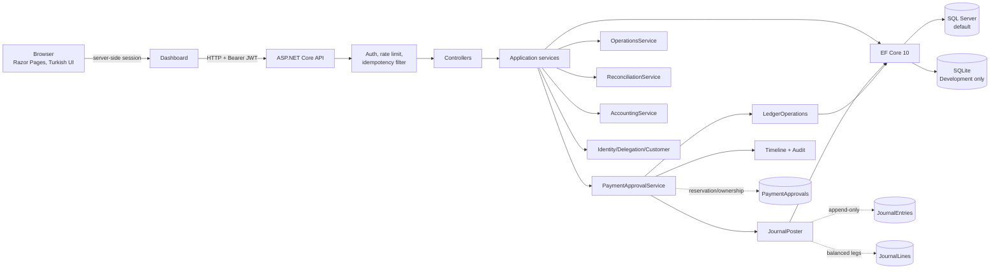
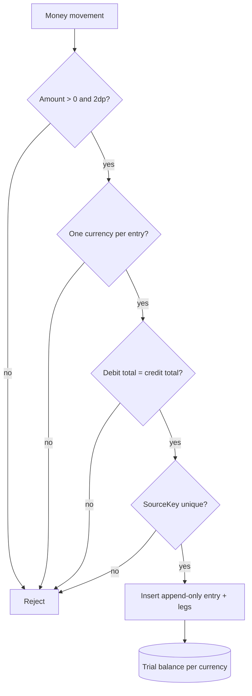

# Architecture and sequences

Date: 2026-10-22. This describes the implemented synthetic demo. It does not
claim production deployment, real general-ledger integration or SQL Server
verification.

## Components



## Approval + journal sequence

```mermaid
sequenceDiagram
    actor C as Customer
    participant API as ASP.NET API
    participant DB as Database
    actor A as Owner / Delegated

    C->>API: POST /api/me/requests
    API->>DB: live user/customer/account/currency/balance checks
    API->>DB: PaymentApproval Pending + timeline + audit (one transaction)
    API-->>C: Pending; no balance/journal change

    A->>API: POST /api/payments/{id}/approve
    API->>DB: re-read role/status/delegation/limit/expiry
    API->>DB: ownership/currency/available balance recheck
    API->>DB: balance + legacy Transaction
    API->>DB: balanced JournalEntry + two JournalLines
    API->>DB: status Approved + timeline + audit
    alt commit
        API->>DB: COMMIT
        API-->>A: Approved
    else journal/unique/DB failure
        API->>DB: ROLLBACK
        Note over API,DB: balance, transaction, journal,<br/>approval, timeline, audit all rolled back
        API-->>A: safe error; request remains Pending
    end
```

## Journal invariants



`SourceKey` values: `approval:<id>`, `baseline:<accountId>`,
`reversal:<journalEntryId>` (reversal reserved, not exposed in this stage).

## Operations sequence

```mermaid
sequenceDiagram
    actor O as Owner / Delegated
    participant API as Operations API
    participant DB as Database

    O->>API: GET /api/operations/summary
    API->>DB: live role/status/delegation
    API->>DB: pending approvals + reconciliation gaps
    API-->>O: scoped counts, age/SLA, unresolved counts

    O->>API: POST /api/operations/approvals/{id}/assignment
    API->>DB: pending + active eligible target + live permission
    API->>DB: assignment + APPROVAL_ASSIGNED audit
    API-->>O: changed / idempotent message
    Note over API,DB: assignment does NOT grant approval;<br/>ApprovePaymentAsync rechecks everything
```

## Trust boundaries

| Boundary | Rule |
|---|---|
| Browser → Dashboard | Server-side session; JWT is not rendered into HTML |
| Dashboard → API | Bearer JWT; role is only a hint |
| API → services | Services re-read user, role, delegation and ownership from DB |
| Services → DB | Money/journal/approval/audit commit in one transaction |
| CSV/import | Synthetic files only; formula-safe export; no live bank connection |
| CI | Loopback synthetic data, temporary SQLite DB, no secrets/artifacts |

## ADRs

- [ADR-0001 — payment and role policy](adr/0001-payment-and-role-policy.md)
- [ADR-0002 — double-entry journal](adr/0002-double-entry-journal.md)

## Known boundaries

- SQL Server is the default provider but was not applied/verified here.
- No real general ledger, FX, fee, interest, regulatory reporting or production
  hardening is claimed.
- No service-to-service messaging, event bus or distributed transaction; the
  atomicity guarantee is the local DB transaction.
